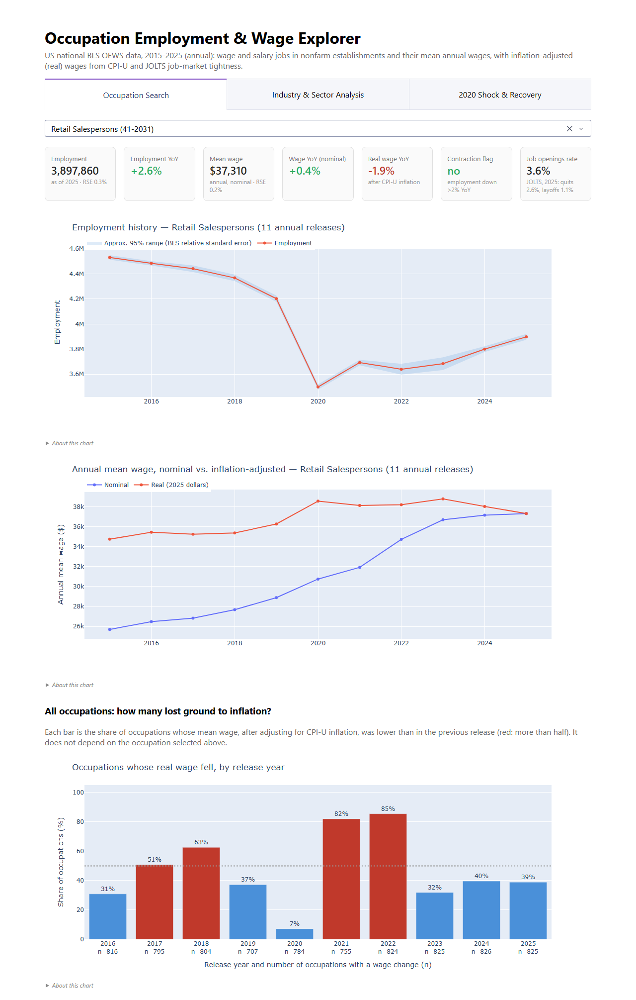

# Occupation Employment & Wage Explorer

[](https://opensource.org/licenses/MIT)
[](https://www.python.org/downloads/)
[](https://dash.plotly.com/)
[](https://github.com/brianravelo28/occupation-employment-wage-explorer/actions/workflows/tests.yml)

An interactive dashboard of US employment and inflation-adjusted pay for about 800 occupations, for job seekers, career advisers and analysts who want to see how occupations have fared. It is built on real data from the Bureau of Labor Statistics (BLS), not synthetic data.

**Live dashboard: [occupation-employment-wage-explorer.onrender.com](https://occupation-employment-wage-explorer.onrender.com/)** — hosted on Render's free tier, which spins the app down when idle, so the first load after a quiet period can take up to a minute.

**What the data show:**
- **Pay fell behind inflation in 2021–22.** More than 80% of US occupations had a real (inflation-adjusted) wage decline in both 2021 (82%) and 2022 (85%), against 7% in 2020 and 32% in 2023. The 2021 figure depends on which month's CPI deflates wages (73–84% across April to July and the annual average); the 2022 figure holds (81–88%). Year-to-year changes are directional, not exact: each survey release pools three years of samples.
- **The 2020 shock was very uneven.** Total US employment fell 5.3% in the 2020 release. Against their own earlier trends, Waiters and Waitresses fell 30 points more, Retail Salespersons 15 and Registered Nurses 3. Responses between −17 and +18 points are within what the same calculation gives in years with no shock. By 2025, the occupations present in every release were at 103% of their 2019 employment. Each release pools three years, so the 2020 figures are smeared; see [the methodology](docs/METHODOLOGY.md#2020-shock-and-recovery).



## Overview

Which jobs are shrinking, and which are quietly losing purchasing power even while nominal pay rises? This project pulls the BLS's Occupational Employment and Wage Statistics (OEWS) into an 11-year annual panel (May 2015 to May 2025, US national), adjusts wages for inflation with the Consumer Price Index for All Urban Consumers (CPI-U), and adds job openings, quits and layoffs rates from the Job Openings and Labor Turnover Survey (JOLTS), which show how tight hiring is in each occupation's industries. JOLTS publishes by industry only, so each occupation gets the rates of its industries, weighted by where its employment sits ([details](docs/METHODOLOGY.md#cpi-and-jolts)).

Use it to look up any occupation's employment and real-wage history, see which jobs are growing or shrinking within each industry, and see how occupations fared in 2020. The raw BLS downloads are not in the repo, but the processed tables are, and every figure quoted in the docs is recomputed from those files by the tests. Growth rates are directional, because OEWS is not designed for year-over-year comparison (see [Limitations](#limitations)).

## What's included

- Annual OEWS data for 2015–2025: 789–831 occupations a year (8,988 occupation × year rows), with year-over-year and five-year growth features
- Inflation-adjusted (real) wages using CPI-U, and the JOLTS tightness rates above, merged into occupation and industry tables
- An industry-sector breakdown: 20 NAICS sectors (North American Industry Classification System), 143–641 occupations each in 2025, 92,104 occupation × sector × year rows
- A 2020 shock-and-recovery view
- A three-tab dashboard deployed on Render
- An executed exploratory data analysis (EDA) notebook, plus tests with continuous integration (CI)

## Quick Start

```bash
git clone https://github.com/brianravelo28/occupation-employment-wage-explorer.git
cd occupation-employment-wage-explorer
pip install -r requirements.txt   # Python 3.12 or newer
python app/app.py
# -> http://localhost:8051
```

The processed datasets are committed under `data/processed/`, so the dashboard runs immediately — no pipeline run required.

### Rebuild everything from raw BLS data (optional)

```bash
# Download BLS OEWS annual archives (~900MB total, ~30-40 min the first time): the MB3
# research estimates for 2015-2020 (data/raw/oews_mb3/) and the standard files for 2021-2025
python data/fetch_oews.py
python data/fetch_oews_industry.py

# BLS API pulls: JOLTS rates (80 series) and CPI-U (10 queries; the unregistered
# limit is 25 queries/day and every response is cached under data/raw/jolts/)
python data/fetch_jolts.py
python data/fetch_cpi.py

# Engineer growth/trend features, then merge in real wages and JOLTS exposure
python src/build_features.py
python src/build_industry_features.py

# Observed 2020 response per occupation, for the 2020 tab
python src/build_shock_replay.py
```

The scripts self-identify to BLS with a `User-Agent` (BLS serves an "Access Denied" page to generic browser user agents). Before running the downloads, create a `.env` file in the repo root containing `BLS_CONTACT_EMAIL=you@example.com` (read by `src/config.py`; `.env` is git-ignored). `BLS_API_KEY` is optional; with a registered key the API allows far more queries and longer windows.

The CPI and JOLTS pulls go through BLS's timeseries API, which returns at most 10 years per query without a key, so each series is fetched in two year-windows (2015–2024, 2025–now) and merged.

### Run the tests

```bash
pip install -r requirements.txt pytest   # or requirements-dev.txt
python -m pytest
```

About 130 tests run in a few seconds with no network access, and automatically on every push through GitHub Actions. They check the data, the calculations, the dashboard callbacks and that every figure in these docs still matches the data; see [docs/TESTING.md](docs/TESTING.md).

### Explore the notebooks

```bash
pip install -r requirements-dev.txt   # adds jupyter + matplotlib on top of requirements.txt
jupyter notebook notebooks/
```
- `01_eda_occupation_panel.ipynb` — employment/wage distributions, growth trends, real wages

## Dashboard

The dashboard has three tabs:

| Tab | What it shows |
|---|---|
| **Occupation Search** | Search any occupation, see employment history, nominal vs. inflation-adjusted wage history, year-over-year trends (employment, nominal wage, real wage), a contraction flag (employment down more than 2% year over year), and the JOLTS job-openings/quits/layoffs rates of the industries it works in. Below the occupation charts, a bar chart shows for every release year the share of all occupations whose real wage fell. |
| **Industry & Sector Analysis** | Pick a NAICS sector, see its JOLTS openings, quits and layoffs rates, a real-or-nominal-wage-growth-vs-employment-change scatter (real by default; the toggle matters mainly for where the zero line falls) and top movers. Occupations under 500 employees within a sector — in either year compared — are excluded from the ranked tables (sampling noise), though still shown in the scatter |
| **2020 Shock & Recovery** | Pick an occupation: employment indexed to the 2019 release (= 100) against the total for the occupations present in every release, the change in the 2020 release, employment now vs. 2019, and the occupation's 2020 response (its change minus its 2016–2019 trend); plus tables of the hardest-hit and most resilient occupations. Occupations under 10,000 employees show their occupation group's response instead, and the card says so |

## Deployment (Render)

The repo is Render-ready as-is: **New > Blueprint** pointed at this repo uses `render.yaml` (Python 3.14.8, `pip install -r requirements.txt`, gunicorn with a threaded worker). No environment variables or secrets are required — the dashboard reads only the processed CSVs committed under `data/processed/`. Manual setup, the start command and a gotcha about editing it are in [docs/DEPLOYMENT.md](docs/DEPLOYMENT.md).

## Project Structure

```
occupation-employment-wage-explorer/
├── README.md              # this file
├── requirements.txt        # runtime deps (what Render installs)
├── requirements-dev.txt    # + jupyter/matplotlib for notebooks
├── Procfile                 # gunicorn start command
├── render.yaml              # Render Blueprint config
├── LICENSE                 # MIT
├── .gitignore
├── data/                   # acquisition scripts (BLS OEWS/JOLTS/CPI fetchers) + processed/ (tracked)
├── src/                    # feature engineering (incl. CPI/JOLTS merge and the 2020 response)
├── notebooks/              # EDA (executed, real outputs)
├── app/                    # Plotly Dash dashboard
├── tests/                  # pytest suite
└── docs/                   # schema, methodology, testing, deployment, data source citations
```

See [docs/SCHEMA.md](docs/SCHEMA.md) for exact column definitions and [docs/METHODOLOGY.md](docs/METHODOLOGY.md) for the full data-architecture and methods writeup.

## Data Sources

- **BLS OEWS** (annual employment/wage by occupation, US national): downloaded directly as archive files, not via the timeseries API — BLS doesn't retain multi-year OEWS history under stable series IDs. See [docs/METHODOLOGY.md](docs/METHODOLOGY.md) for how this was verified.
- **BLS JOLTS** (monthly job openings, hires, quits, layoffs and separations rates, national and industry-level only — not occupation-level): pulled through the timeseries API (16 industries, through August 2026; only calendar years up to 2025 are used) and merged into the occupation and industry feature tables.
- **BLS CPI-U** (all items, US city average, not seasonally adjusted, series `CUUR0000SA0`): used to express wages in constant 2025 dollars, deflating each OEWS year with May CPI.

The OEWS reference period is May of each year (May 2015 to May 2025). The processed tables were last rebuilt from BLS on 3 November 2026.

Full citations and API documentation links: [docs/CITATIONS.md](docs/CITATIONS.md).

## Limitations

- **OEWS is not built for year-over-year comparison.** BLS's own FAQ says the survey is designed for cross-sectional estimates and is "less useful for looking at changes over time", citing classification changes and its three-year pooled sample ([BLS: Can OEWS data be used to look at changes over time?](https://www.bls.gov/oes/oes_ques.htm)). Every growth rate on the dashboard inherits that: the numbers are best read as directional, and consecutive releases share most of their underlying survey panels.
- **Small occupations are noisy.** Occupations with employment in the tens or hundreds show large year-over-year swings from OEWS sampling variance. The sector tab leaves them out of its rankings; the notebook's top-movers tables don't. Details in [the methodology](docs/METHODOLOGY.md#known-limitations).
- **Annual, not monthly.** OEWS is a point-in-time annual survey.

## License

MIT License — see [LICENSE](LICENSE). Part of my [data portfolio](https://brblitz.com/data-portfolio.html).
