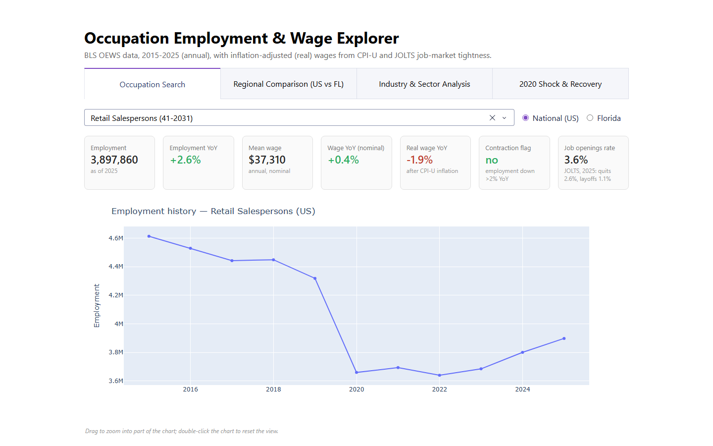

# Occupation Employment & Wage Explorer



[](https://opensource.org/licenses/MIT)
[](https://www.python.org/downloads/)
[](https://dash.plotly.com/)
[](https://github.com/brianravelo28/occupation-employment-wage-explorer/actions/workflows/tests.yml)

An interactive dashboard and data pipeline for occupation-level employment and wages in the US and Florida, built on real data from the Bureau of Labor Statistics (BLS), not synthetic data. It describes what the data show and makes no forecasts.

**Live dashboard: [occupation-employment-wage-explorer.onrender.com](https://occupation-employment-wage-explorer.onrender.com/)** — hosted on Render's free tier, which spins the app down when idle, so the first load after a quiet period can take up to a minute.

## Overview

Which jobs are shrinking, and which are quietly losing purchasing power even while nominal pay rises? This project pulls the BLS's Occupational Employment and Wage Statistics (OEWS) into an 11-year annual panel (about 800 occupations, national and statewide Florida), adjusts wages for inflation with the Consumer Price Index for All Urban Consumers (CPI-U), and adds job openings, quits and layoffs rates from the Job Openings and Labor Turnover Survey (JOLTS), which show how tight hiring is in each occupation's industries.

Use it to look up any occupation's employment and real-wage history, compare Florida with the nation, see which jobs are growing or shrinking within each industry, and see how occupations fared in 2020. Every figure comes from BLS files committed in this repo and reproduced by its code and tests. Growth rates are directional, because OEWS is not designed for year-over-year comparison (see [Limitations](#limitations)).

**Findings:**
- 💵 **Pay fell behind inflation in 2021–22.** More than 80% of US occupations had a real (inflation-adjusted) wage decline in both years, against 7% in 2020 and 32% in 2023. Over 2015–2025 the median US occupation's real wage rose just 0.8% in total.
- 📉 **The 2020 shock was very uneven.** Total US employment fell 5.3% in the 2020 release (Florida 4.2%). Against their own earlier trends, Waiters and Waitresses fell 25 points more, Retail Salespersons 14 and Registered Nurses 2. By 2025, the occupations present in every release were at 103% of their 2019 employment nationally and 110% in Florida. See [the methodology](docs/METHODOLOGY.md#2020-shock-and-recovery).
- 🗺️ **For the same job, Florida pays about 8% less than the national average.** Across the 777 occupations compared head-to-head, the median gap is 7.7%, and 84% pay less in Florida. These are nominal wages, not adjusted for cost of living, so they don't show differences in purchasing power. The Regional Comparison tab's median bars ($66,290 nationally, $58,730 in Florida) imply a larger gap, about 11%, because they compare each region's middle occupation rather than the same job. [Details in the methodology](docs/METHODOLOGY.md#florida-vs-national-wages).
- 📈 **Job-market tightness by occupation.** JOLTS publishes by industry only, so each occupation gets the rates of its industries, weighted by where its employment sits. See [the methodology](docs/METHODOLOGY.md#cpi-and-jolts).

## What's included

- Annual OEWS data for 2015–2025: 789–831 occupations a year (17,587 occupation × region × year rows, national and statewide Florida), with year-over-year and five-year growth features
- Inflation-adjusted (real) wages using CPI-U, and the JOLTS tightness rates above, merged into occupation and industry tables
- An industry-sector breakdown: 20 NAICS sectors (North American Industry Classification System), 143–641 occupations each in 2025, 92,104 occupation × sector × year rows
- A 2020 shock-and-recovery view
- A four-tab dashboard deployed on Render
- An executed exploratory data analysis (EDA) notebook, plus tests with continuous integration (CI)

## Quick Start

```bash
git clone https://github.com/brianravelo28/occupation-employment-wage-explorer.git
cd occupation-employment-wage-explorer
pip install -r requirements.txt   # Python 3.12 or newer
python app/app.py
# -> http://localhost:8051
```

The processed datasets are committed under `data/processed/`, so the dashboard runs immediately — no pipeline run required.

### Rebuild everything from raw BLS data (optional)

```bash
# Download BLS OEWS annual archives, 2015-2025 (~900MB total, ~30-40 min the first time)
python data/fetch_oews.py
python data/fetch_oews_industry.py

# BLS API pulls: JOLTS rates (85 series) and CPI-U (10 queries; the unregistered
# limit is 25 queries/day and every response is cached under data/raw/jolts/)
python data/fetch_jolts.py
python data/fetch_cpi.py

# Engineer growth/trend features, then merge in real wages and JOLTS exposure
python src/build_features.py
python src/build_industry_features.py

# Observed 2020 response per occupation, for the 2020 tab
python src/build_shock_replay.py
```

The scripts self-identify to BLS with a `User-Agent` (BLS serves an "Access Denied" page to generic browser user agents). Before running the downloads, create a `.env` file in the repo root containing `BLS_CONTACT_EMAIL=you@example.com` (read by `src/config.py`; `.env` is git-ignored). `BLS_API_KEY` is optional; with a registered key the API allows far more queries and longer windows.

The CPI and JOLTS pulls go through BLS's timeseries API, which returns at most 10 years per query without a key, so each series is fetched in two year-windows (2015–2024, 2025–now) and merged.

### Run the tests

This project includes 100+ tests that check the pipeline is correct and repeatable: that the data is clean and consistent, that the calculations produce the right numbers, and that the dashboard shows what the data say. If a change breaks any of that, the tests catch it.

A few examples of what they check:
- **Data integrity:** keys are unique, every year is present, and real wages equal nominal wages in the base year (a sanity check that the inflation adjustment works)
- **Calculations:** year-matched lags (a change is computed against the actual prior year, never a gap), growth features, the CPI and JOLTS merges, and the 2020 shock-and-recovery table
- **Repeatability:** the committed 2020 table matches what the current data produce when rebuilt
- **Documentation:** every figure quoted in the README and methodology (the Florida wage gaps, the real-wage shares, the 2020 responses and so on) is recomputed from the committed data by `src/doc_figures.py` and must appear in the docs exactly as computed
- **Data fetching:** quirks of the BLS API, such as a request that reports success but returns no data
- **Dashboard:** every callback (the function behind each chart and filter) returns the expected output

They run in a few seconds with no network access, and automatically on every push through GitHub Actions. They don't cover page layout or the live Render deployment.

```bash
pip install -r requirements.txt pytest   # or requirements-dev.txt
python -m pytest
```

### Explore the notebooks

```bash
pip install -r requirements-dev.txt   # adds jupyter + matplotlib on top of requirements.txt
jupyter notebook notebooks/
```
- `01_eda_occupation_panel.ipynb` — employment/wage distributions, regional comparison, growth trends, real wages

## Dashboard

The dashboard has four tabs:

| Tab | What it shows |
|---|---|
| **Occupation Search** | Search any occupation, see employment history, nominal vs. inflation-adjusted wage history, year-over-year trends (employment, nominal wage, real wage), a contraction flag (employment down more than 2% year over year), and the JOLTS job-openings/quits/layoffs rates of the industries it works in, US or FL. |
| **Regional Comparison** | US vs. Florida, counting either each occupation or each worker (employment-weighted) equally via a toggle: employment growth (median with 25th–75th percentile whiskers, since a median-only bar hid how much occupations actually vary), the median across occupations of each occupation's mean annual wage, the share of occupations with nominal and with real (after-CPI) wage decline, the share contracting, and the JOLTS job-openings rate |
| **Industry & Sector Analysis** | Pick a NAICS sector, see its JOLTS openings, quits and layoffs rates, a real-or-nominal-wage-growth-vs-employment-change scatter (real by default; the toggle matters mainly for where the zero line falls) and top movers. Occupations under 500 employees within a sector — in either year compared — are excluded from the ranked tables (sampling noise), though still shown in the scatter |
| **2020 Shock & Recovery** | Pick an occupation and region: employment indexed to the 2019 release (= 100) against the total for the occupations present in every release, the change in the 2020 release, employment now vs. 2019, and the occupation's 2020 response (its change minus its 2016–2019 trend); plus tables of the hardest-hit and most resilient occupations. Occupations under 10,000 employees show their occupation group's response instead, and the card says so |

## Deployment (Render)

The repo is Render-ready as-is:

1. On [render.com](https://render.com), **New > Blueprint**, point it at this repo — `render.yaml` configures the build (`pip install -r requirements.txt`) and start command.
2. Or create a **New > Web Service** manually (Python 3.12+, free plan is fine) with build command `pip install -r requirements.txt` and start command:

   ```bash
   gunicorn app.app:server --bind 0.0.0.0:$PORT --worker-class gthread --workers 1 --threads 4 --timeout 120
   ```

**Why a threaded worker:** Dash fires every tab's callbacks as simultaneous requests on page load. With gunicorn's default single sync worker those requests queue one at a time, and on Render's free tier a slow one could wait long enough to hit the 30-second default timeout — surfacing as intermittent `502`s and a blank tab. Threads share the already-loaded data inside one process (unlike extra worker processes, which would each duplicate it).

**Gotcha:** for a service created manually, the Start Command lives in Render's dashboard settings — editing `Procfile`/`render.yaml` later does *not* change an existing service. Update it under **Settings > Start Command**.

No environment variables or secrets are required — the dashboard reads only the processed CSVs committed under `data/processed/` (unlike the raw BLS archives, which are git-ignored; see [.gitignore](.gitignore) for why: Render can't reliably regenerate them at build time, since BLS's API has had multi-day outages).

`app/app.py`'s `if __name__ == "__main__"` block is for local dev (`python app/app.py`; reads `PORT`/`DASH_DEBUG` env vars, defaults to port 8051 with debug on). In production, gunicorn serves `app.app:server` per the `Procfile`.

## Project Structure

```
occupation-employment-wage-explorer/
├── README.md              # this file
├── requirements.txt        # runtime deps (what Render installs)
├── requirements-dev.txt    # + jupyter/matplotlib for notebooks
├── Procfile                 # gunicorn start command
├── render.yaml              # Render Blueprint config
├── LICENSE                 # MIT
├── .gitignore
├── data/                   # acquisition scripts (BLS OEWS/JOLTS/CPI fetchers) + processed/ (tracked, see Deployment)
├── src/                    # feature engineering (incl. CPI/JOLTS merge and the 2020 response)
├── notebooks/              # EDA (executed, real outputs)
├── app/                    # Plotly Dash dashboard
└── docs/                   # schema, methodology, data source citations
```

See [docs/SCHEMA.md](docs/SCHEMA.md) for exact column definitions and [docs/METHODOLOGY.md](docs/METHODOLOGY.md) for the full data-architecture and methods writeup.

## Data Sources

- **BLS OEWS** (annual employment/wage by occupation): downloaded directly as archive files, not via the timeseries API — BLS doesn't retain multi-year OEWS history under stable series IDs. See [docs/METHODOLOGY.md](docs/METHODOLOGY.md) for how this was verified.
- **BLS JOLTS** (monthly job openings, hires, quits, layoffs and separations rates, industry-level only — not occupation-level; state-level only for Florida total nonfarm): pulled through the timeseries API (US 16 industries and Florida total nonfarm; the US runs through August 2026 and Florida through December 2025 because state data lag, and only calendar years up to 2025 are used) and merged into the occupation and industry feature tables.
- **BLS CPI-U** (all items, US city average, not seasonally adjusted, series `CUUR0000SA0`): used to express wages in constant 2025 dollars, deflating each OEWS year with May CPI.

Full citations and API documentation links: [docs/CITATIONS.md](docs/CITATIONS.md).

## Limitations

- **OEWS is not built for year-over-year comparison.** BLS's own FAQ says the survey is designed for cross-sectional estimates and is "less useful for looking at changes over time", citing classification changes and its three-year pooled sample ([BLS: Can OEWS data be used to look at changes over time?](https://www.bls.gov/oes/oes_ques.htm)). Every growth rate on the dashboard inherits that: the numbers are best read as directional, and consecutive releases share most of their underlying survey panels.
- **Small occupations are noisy.** Occupations with employment in the tens or hundreds show large year-over-year swings from OEWS sampling variance. The sector tab leaves them out of its rankings; the notebook's top-movers tables don't. Some BLS estimates are carried forward unchanged between releases (in the 2024 release this put Florida's median employment growth at exactly 0.0%). Details in [the methodology](docs/METHODOLOGY.md#known-limitations).
- **Annual, not monthly.** OEWS is a point-in-time annual survey.

## License

MIT License — see [LICENSE](LICENSE).
